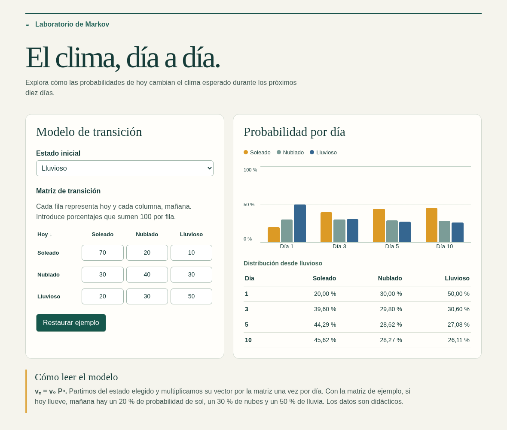

# SDD-Markov-Clima

Simulador web en español de una cadena de Markov para el clima. Selecciona el estado de hoy y modifica la matriz para comparar las probabilidades de sol, nubes y lluvia dentro de **1, 3, 5 y 10 días**.



## Ejecutar la aplicación

Requiere el SDK de .NET 8. Desde la raíz del repositorio:

```bash
dotnet run --project src/Markov.Web --no-launch-profile --urls http://localhost:5057
```

Abre **http://localhost:5057**. El ejemplo comienza en Lluvioso. Cambia a Soleado para ver 70 % de sol al día siguiente. Cambia la primera celda de 70 a 65 para ver el error de la fila que suma 95 %. El botón **Restaurar ejemplo** recupera la matriz y el estado inicial. El formulario acepta coma o punto decimal.

## Modelo matemático

Un paso representa un día. El modelo supone que, dado el clima de hoy, la distribución de mañana depende solo de ese estado y que las probabilidades de transición permanecen constantes. Los porcentajes son didácticos. Para estimar el clima de una ciudad harían falta observaciones y validación con datos históricos.

| Hoy / mañana | Soleado | Nublado | Lluvioso |
|---|---:|---:|---:|
| Soleado | 70 % | 20 % | 10 % |
| Nublado | 30 % | 40 % | 30 % |
| Lluvioso | 20 % | 30 % | 50 % |

Se divide cada celda entre 100 para obtener la matriz **P**. La distribución inicial es un vector fila. Para lluvia, **v₀ = (0, 0, 1)**. Cada día se calcula **vₙ₊₁ = vₙ P**, equivalente a **vₙ = v₀ Pⁿ**. Por ejemplo, al día 1 resulta (0,20; 0,30; 0,50). Al día 2 la probabilidad de sol es **0,20 × 0,70 + 0,30 × 0,30 + 0,50 × 0,20 = 0,33**. La tabla resume la misma evolución a los cuatro horizontes. Se redondea únicamente al mostrar los datos.

| Día desde Lluvioso | Soleado | Nublado | Lluvioso |
|---:|---:|---:|---:|
| 1 | 20,00 % | 30,00 % | 50,00 % |
| 3 | 39,60 % | 29,80 % | 30,60 % |
| 5 | 44,29 % | 28,62 % | 27,08 % |
| 10 | 45,62 % | 28,27 % | 26,11 % |

## Arquitectura y trazabilidad

[Markov.Core](src/Markov.Core/WeatherChain.cs) valida la matriz y calcula el vector para cada día. [Markov.Web](src/Markov.Web/Components/Simulator.razor) utiliza Blazor Interactive Server para actualizar la tabla y las barras desde el mismo resultado. Los datos viven en la sesión del simulador. La aplicación funciona sin una base de datos ni servicios meteorológicos.

| Requisito | Evidencia automatizada |
|---|---|
| [MOD-01 · Matriz válida](openspec/specs/modelo/spec.md) | [Valores negativos, mayores que 100, fila que suma 95 y dimensiones inválidas](tests/Markov.Core.Tests/ChainTests.cs) |
| [MOD-02 · Distribución por horizonte](openspec/specs/modelo/spec.md) | [Referencias numéricas para los cuatro días y estado inicial fuera de rango](tests/Markov.Core.Tests/ChainTests.cs) |
| [MOD-03 · Evolución](openspec/specs/modelo/spec.md) | [Conservación de masa, identidad y ciclo desde los tres estados](tests/Markov.Core.Tests/ChainTests.cs) |
| [WEB-01 · Edición y restauración](openspec/specs/simulador/spec.md) | [Cambio de estado, restauración y edición de matriz](tests/web/simulador.test.mjs) |
| [WEB-02 · Errores](openspec/specs/simulador/spec.md) | [Fila inválida y celda vacía, retirada de resultados y recuperación](tests/web/simulador.test.mjs) |
| [WEB-03 · Gráfica y tabla](openspec/specs/simulador/spec.md) | [Cuatro grupos y doce barras cotejadas con los porcentajes de la tabla](tests/web/simulador.test.mjs) |

## OpenSpec, SDD y participación de IA

Cada capacidad comenzó con una propuesta, decisiones de diseño, requisitos con escenarios WHEN/THEN y una lista de tareas. Los commits `spec(modelo)` y `spec(web)` preceden al código de su respectiva capacidad. Las [especificaciones vigentes](openspec/specs) describen el producto y los [cambios archivados](openspec/changes/archive) conservan la intención original. Puedes seguir el proceso con `git log --reverse --oneline`.

El usuario definió los criterios académicos y aprobó el plan. Codex redactó los escenarios, implementó el motor y la web, escribió las pruebas y ejecutó las verificaciones. Las referencias numéricas del ejemplo se calcularon independientemente con aritmética racional. Las pruebas de identidad y ciclo permiten comprobar el número de transiciones a mano.

## Reproducir la verificación

Con .NET 8 y Node.js 24, desde la raíz:

```bash
dotnet build Clima.sln
dotnet test Clima.sln
npm ci
npm run spec
npx playwright-core install chromium --only-shell
```

Para las pruebas de navegador, deja la aplicación en ejecución en el puerto 5057 y, en otra terminal, ejecuta `npm run test:web`. En Linux, si faltan dependencias del sistema, usa `npx playwright-core install --with-deps chromium --only-shell`. Puedes ajustar `MARKOV_URL` para probar otra instancia y `CHROMIUM_PATH` para usar un ejecutable de Chromium instalado.

La verificación local cubre **8 casos xUnit, 3 pruebas de navegador y 2 capacidades OpenSpec**. [GitHub Actions](.github/workflows/verificar.yml) repite la validación, la compilación y ambas suites con cada push o pull request.
